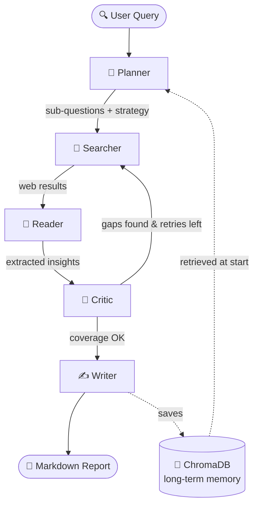
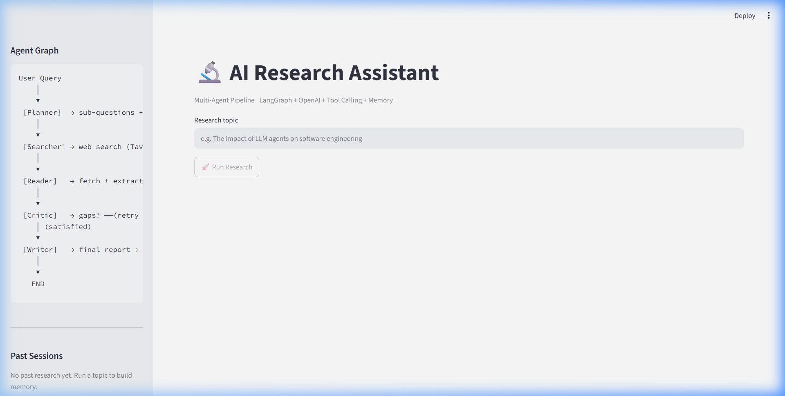
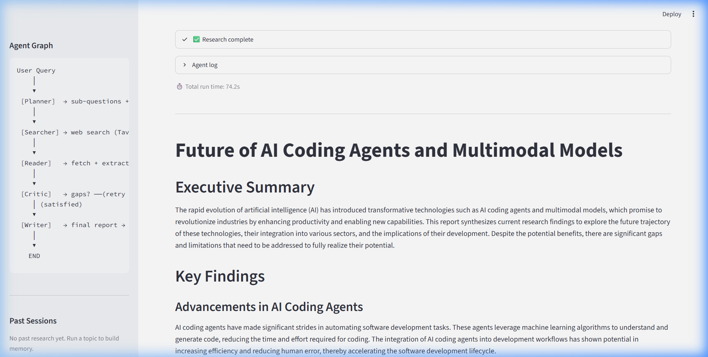

<div align="center">

# 🔬 AI Research Assistant Pipeline

### An autonomous **multi-agent** system that researches any topic end-to-end — then remembers what it learned.

<p>
  <a href="https://ayushdas4890-ai-research-assistant-pipeline-app-1sjuvf.streamlit.app/" target="_blank">
    
  </a>
  
  
  
  
  
  
</p>

<p>
  <a href="https://ayushdas4890-ai-research-assistant-pipeline-app-1sjuvf.streamlit.app/"><b>Live Demo</b></a> ·
  <a href="#-quick-start"><b>Quick Start</b></a> ·
  <a href="#-architecture"><b>Architecture</b></a> ·
  <a href="#-the-five-agents"><b>Agents</b></a> ·
  <a href="#-how-memory-works"><b>Memory</b></a>
</p>

</div>

---

> Give it a topic. Five specialised agents **plan** sub-questions, **search** the web, **read** and extract insights, **critique** their own coverage (and re-search if there are gaps), then **write** a structured, sourced report — all streamed live to your browser, and saved to a vector store so the next run on a related topic is smarter.

---

## 📑 Table of Contents

- [✨ Features](#-features)
- [🧠 Architecture](#-architecture)
- [🤖 The Five Agents](#-the-five-agents)
- [🗂 Project Structure](#-project-structure)
- [⚡ Quick Start](#-quick-start)
- [🔑 API Keys](#-api-keys)
- [🚀 Running It](#-running-it)
- [💾 How Memory Works](#-how-memory-works)
- [🛡 Error Handling](#-error-handling)
- [🔭 Observability](#-observability)
- [📸 Screenshots](#-screenshots)
- [🧰 Tech Stack](#-tech-stack)
- [🗺 Roadmap](#-roadmap)
- [🤝 Contributing](#-contributing)
- [📄 License](#-license)

---

## ✨ Features

- 🧩 **5-agent LangGraph `StateGraph`** with conditional routing and a self-critique retry loop.
- 🔁 **Self-correcting** — the Critic detects coverage gaps and loops back to search again (max 2 retries).
- 💾 **Dual-layer memory** — short-term typed graph state + long-term **ChromaDB** vector store; research improves across sessions.
- 🔧 **Tool-calling pipeline** — Tavily web search + BeautifulSoup URL fetcher, structured JSON exchange.
- ⚡ **Live streaming web UI** — watch each agent execute in real time over **Server-Sent Events**.
- 🔭 **LangSmith tracing** — every step, tool call, and routing decision is inspectable.
- 🛡 **Graceful degradation** — bad URLs, API failures, and missing memory never crash the run.

---

## 🧠 Architecture



**Routing rules** (`graph/edges.py`):

| After Critic | Condition | Goes to |
|---|---|---|
| Gaps found **and** `retry_count < 2` | re-search | **Searcher** |
| No gaps **or** retries exhausted | done | **Writer** |
| After Writer | always | **END** |

---

## 🤖 The Five Agents

<details>
<summary><b>🧭 Planner</b> — decomposes the topic</summary>

Breaks your query into 3–5 focused sub-questions plus a one-line strategy. If similar past research exists in memory, it's injected so the plan builds on prior knowledge. → `agents/planner.py`
</details>

<details>
<summary><b>🔎 Searcher</b> — searches the web</summary>

Runs a Tavily search per sub-question, dedupes by URL. On a retry it uses the Critic's gap notes to run targeted follow-up searches and appends to results. → `agents/searcher.py`
</details>

<details>
<summary><b>📖 Reader</b> — extracts insights</summary>

Fetches each URL, strips it to clean text, and asks the LLM for key points + a relevance score. Anything below 0.4 is discarded; already-read URLs are skipped on retries. → `agents/reader.py`
</details>

<details>
<summary><b>🧪 Critic</b> — reviews its own work</summary>

Judges whether sub-questions are answered and whether gaps remain. If so (and retries remain) it sends the graph back to the Searcher. A retry cap prevents infinite loops. → `agents/critic.py`
</details>

<details>
<summary><b>✍️ Writer</b> — synthesises the report</summary>

Compiles all surviving insights (and prior context) into a structured Markdown report — Executive Summary, Key Findings, Analysis, Gaps, Sources — then saves it to long-term memory. → `agents/writer.py`
</details>

---

## 🗂 Project Structure

```
AI-Research-Assistant-Pipeline/
├── server.py                # FastAPI backend + SSE streaming  ⭐ main entry
├── main.py                  # CLI runner
├── app.py                   # Streamlit UI (legacy)
├── web/                     # Modern frontend (no build step)
│   ├── index.html
│   ├── styles.css
│   └── app.js
├── graph/
│   ├── state.py             # ResearchState TypedDict
│   ├── graph_builder.py     # StateGraph assembly
│   └── edges.py             # Conditional routing
├── agents/                  # planner · searcher · reader · critic · writer
├── tools/                   # search_tool · fetch_tool · memory_tool · schemas
├── memory/                  # short_term (state helpers) · long_term (ChromaDB)
├── utils/                   # logger · helpers (LLM client + JSON-with-retry)
├── .github/                 # CI workflow + issue/PR templates
├── requirements.txt
└── .env.example
```

---

## ⚡ Quick Start

```bash
git clone https://github.com/AyushDas4890/AI-Research-Assistant-Pipeline.git
cd AI-Research-Assistant-Pipeline

python -m venv venv
source venv/bin/activate          # Windows: venv\Scripts\activate

pip install -r requirements.txt
cp .env.example .env              # then add your keys (see below)

uvicorn server:app --reload       # open http://localhost:8000
```

> `uuid` is part of Python's standard library, so it is intentionally **not** in `requirements.txt`.

---

## 🔑 API Keys

| Key | Required? | Get it at |
|---|---|---|
| `OPENAI_API_KEY` | ✅ Required — every agent calls the LLM | <https://platform.openai.com/api-keys> |
| `TAVILY_API_KEY` | ✅ Required — web search | <https://app.tavily.com> (free tier) |
| `LANGCHAIN_API_KEY` | ⚪ Optional — LangSmith tracing | <https://smith.langchain.com> |

Fill them into `.env`:

```ini
OPENAI_API_KEY=sk-...
OPENAI_MODEL=gpt-4o
TAVILY_API_KEY=tvly-...
LANGCHAIN_API_KEY=...
LANGCHAIN_TRACING_V2=true
LANGCHAIN_PROJECT=ai-research-assistant
```

> ⚠️ **Never commit `.env`.** It's already in `.gitignore`.

---

## 🚀 Running It

<details open>
<summary><b>🌐 Web app (recommended)</b></summary>

```bash
uvicorn server:app --reload
# open http://localhost:8000
```

A modern single-page UI: animated 5-stage pipeline tracker, live stat counters, a streaming agent console, the rendered Markdown report (copy + download), and a clickable history of past sessions. Progress streams from the backend via **Server-Sent Events**.

| Endpoint | Purpose |
|---|---|
| `GET /` | Serves the single-page app |
| `GET /api/research/stream?query=` | SSE stream of live agent progress |
| `GET /api/sessions` | List past research sessions |
| `GET /api/report/{id}` | Full saved report for a session |
</details>

<details>
<summary><b>💻 CLI</b></summary>

```bash
python main.py
# Enter research topic: <your topic>
```
</details>

<details>
<summary><b>📊 Streamlit (legacy)</b></summary>

```bash
streamlit run app.py
```
</details>

---

## 💾 How Memory Works

**Short-term** — LangGraph threads the full `ResearchState` TypedDict through every node automatically. The `agent_log` field uses `Annotated[List[str], operator.add]`, so each agent *appends* rather than overwrites.

**Long-term** — when the Writer finishes, the report is embedded with `sentence-transformers` and stored in **ChromaDB**. At the start of every run, `retrieve_past_research` finds semantically similar past reports and injects them into `state["past_context"]`.

> 🔁 Research the same topic twice and the second run prints **"Prior research found in memory"** — it's reading what the first run learned.

---

## 🛡 Error Handling

| Failure | Behaviour |
|---|---|
| LLM call raises | Caught, logged, agent returns partial state |
| Model returns non-JSON | Retried once with a strict reminder, then safe default |
| `fetch_url` fails | Returns `""`; Reader skips that source |
| ChromaDB unavailable | Logged warning; pipeline runs without memory |
| Anything in `graph.invoke()` | Wrapped in try/except in `main.py` |

---

## 🔭 Observability

With `LANGCHAIN_TRACING_V2=true`, every run is traced in LangSmith automatically. Each agent also appends a structured log line, surfaced live in the UI:

```text
[PLANNER] Generated 4 sub-questions | strategy: focused literature review
[SEARCHER] Found 18 unique results across 4 queries | retry: 0
[READER] Extracted insights from 11/18 new sources | avg relevance: 0.73
[CRITIC] Coverage: 0.82 | gaps_found: True | retry_count: 1
[WRITER] Report generated | 1,842 words | saved to memory
```

---

## 📸 Screenshots

> _Add screenshots/GIFs of the web UI here once you run it locally._
> Save images to `docs/` and reference them, e.g.:
>
> ```markdown
> 
> 
> ```

---

## 🧰 Tech Stack

`LangGraph` · `OpenAI gpt-4o` · `Tavily` · `ChromaDB` · `sentence-transformers` · `FastAPI` · `Uvicorn` · `Vanilla JS` · `BeautifulSoup` · `LangSmith`

---

## 🗺 Roadmap

- [ ] Stream tokens of the final report as it's written
- [ ] Configurable agent count / model per agent
- [ ] Export reports to PDF
- [ ] Pluggable search backends (Brave, SerpAPI)
- [ ] Dockerfile + one-command deploy

---

## 🤝 Contributing

Contributions are welcome! See **[CONTRIBUTING.md](CONTRIBUTING.md)** and our **[Code of Conduct](CODE_OF_CONDUCT.md)**. Open an issue with the provided templates, or send a PR.

---

## 📄 License

Released under the **[MIT License](LICENSE)** © 2026 Ayush Das.

<div align="center"><sub>Built with LangGraph, OpenAI, and a healthy retry loop. ⭐ Star the repo if it helped you.</sub></div>
